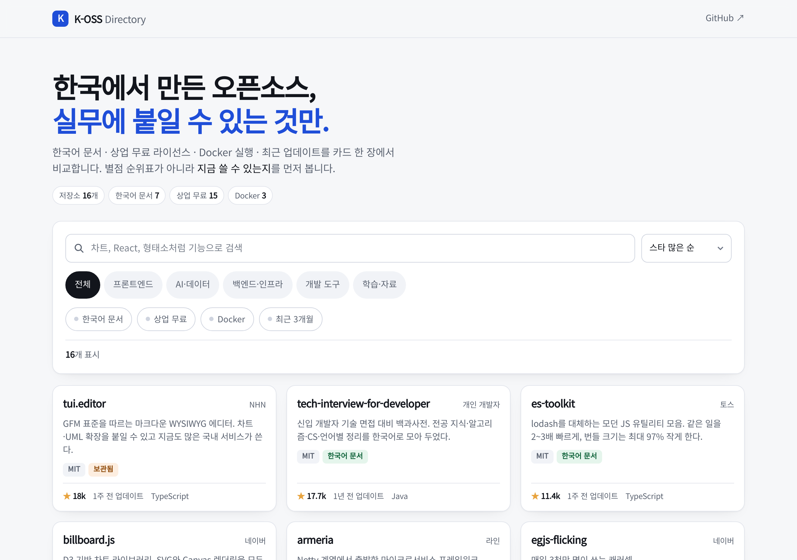
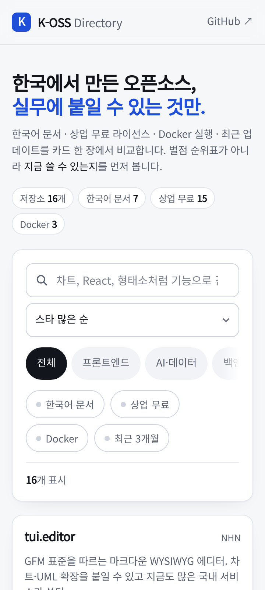

# K-OSS Directory

**한국 개발자가 만든, 한국어로 쓸 수 있는 오픈소스를 한 화면에서.**

GitHub Explore는 트렌딩만 보여주고, 국산 오픈소스는 언어 장벽·라이선스 불안·실행 장벽·관리 중단 때문에 매번 검색에서 걸러집니다.
K-OSS Directory는 **한국 팀·기업·개인 개발자의 저장소만** 모아, 실무에 바로 붙일 수 있는지 네 가지로 판정해 카드 한 장에 보여줍니다.

- 🇰🇷 **국산 한정** — 사람이 검수한 목록
- 📘 **한국어 문서 여부** — README 한글 비중·`README.ko.md` 존재를 자동 판정
- ⚖️ **상업 무료 라이선스** — SPDX 허용 목록(MIT·Apache-2.0·BSD·ISC·MPL-2.0 등) 대조
- 🐳 **Docker 실행** — Dockerfile·공식 이미지 확인 + `최근 3개월` 필터

<p>
  
</p>
<p>
  
  
</p>

## 지금 수록된 저장소 (16개, 2026-11-26 GitHub API로 검증)

| 저장소 | 만든 곳 | 분류 | ★ | 라이선스 |
|---|---|---|---|---|
| [nhn/tui.editor](https://github.com/nhn/tui.editor) | NHN | 개발 도구 | 18.0k | MIT |
| [gyoogle/tech-interview-for-developer](https://github.com/gyoogle/tech-interview-for-developer) | 개인 | 학습·자료 | 17.7k | MIT |
| [toss/es-toolkit](https://github.com/toss/es-toolkit) | 토스 | 프론트엔드 | 11.4k | MIT |
| [naver/billboard.js](https://github.com/naver/billboard.js) | 네이버 | 프론트엔드 | 6.0k | MIT |
| [line/armeria](https://github.com/line/armeria) | 라인 | 백엔드·인프라 | 5.2k | Apache-2.0 |
| [naver/egjs-flicking](https://github.com/naver/egjs-flicking) | 네이버 | 프론트엔드 | 2.9k | MIT |
| [naver/egjs-infinitegrid](https://github.com/naver/egjs-infinitegrid) | 네이버 | 프론트엔드 | 2.4k | MIT |
| [kakao/khaiii](https://github.com/kakao/khaiii) | 카카오 | AI·데이터 | 1.5k | Apache-2.0 |
| [kakaobrain/pororo](https://github.com/kakaobrain/pororo) | 카카오브레인 | AI·데이터 | 1.3k | Apache-2.0 |
| [daangn/seed-design](https://github.com/daangn/seed-design) | 당근 | 프론트엔드 | 1.2k | Apache-2.0 |
| [toss/suspensive](https://github.com/toss/suspensive) | 토스 | 프론트엔드 | 1.1k | MIT |
| [daangn/stackflow](https://github.com/daangn/stackflow) | 당근 | 프론트엔드 | 1.0k | MIT |
| [amondnet/vercel-action](https://github.com/amondnet/vercel-action) | 개인 | 개발 도구 | 764 | MIT |
| [toss/overlay-kit](https://github.com/toss/overlay-kit) | 토스 | 프론트엔드 | 739 | MIT |
| [line/centraldogma](https://github.com/line/centraldogma) | 라인 | 백엔드·인프라 | 675 | Apache-2.0 |
| [YunhuPark/devorch](https://github.com/YunhuPark/devorch) | 직접 만듦 | 개발 도구 | 0 | 미지정 |

> 별점 수치는 `public/data/catalog.json`이 매일 자동 갱신됩니다. 위 표는 작성 시점 기준입니다.

## 구조

```
data/repos.json              # 사람이 관리하는 큐레이션 원본 (무엇을 넣을지·분류·한 줄 소개)
public/                      # 배포되는 정적 사이트 (빌드 없음)
  index.html · styles.css · app.js
  lib/filter.mjs             # 검색·필터·정렬 (브라우저와 테스트가 함께 사용)
  data/catalog.json          # 스크립트가 만드는 생성물 (스타·라이선스·최근 푸시·판정)
scripts/
  sync_repos.mjs             # GITHUB_TOKEN으로 catalog.json 생성 (CI)
  seed_from_gh.mjs           # gh CLI로 catalog.json 생성 (로컬, 토큰 불필요)
  serve.mjs                  # 로컬 미리보기 서버
  ui_check.mjs               # 360/1280 헤드리스 브라우저 검증 + 스크린샷
  tests/                     # node --test 단위 테스트
docs/workflows/sync.yml      # 일일 동기화 워크플로 (.github/workflows로 옮기면 활성화)
.github/ISSUE_TEMPLATE/submit-repo.yml   # 저장소 제보 폼
PRD.md                       # 기획서 (화면·데이터 모델·아키텍처·로드맵)
```

**운영비 0원**: 서버·DB 없음. 정적 파일 + GitHub Actions(하루 1회) + Cloudflare Pages 무료 플랜.

## 로컬에서 실행

Node 22 이상이면 됩니다. 설치할 패키지는 없습니다.

```bash
node scripts/serve.mjs          # → http://localhost:4173
node --test scripts/tests/*.test.mjs   # 단위 테스트
```

`public/data/catalog.json`은 이미 저장소에 포함되어 있어 바로 뜹니다.
데이터를 새로 받고 싶다면 (`gh` 로그인 상태에서):

```bash
node scripts/seed_from_gh.mjs
```

## 저장소 추가·수정

1. `data/repos.json`의 `repos` 배열에 항목을 추가합니다.
   ```jsonc
   {
     "repo": "owner/name",          // 필수
     "vendor": "토스",               // 만든 곳 (표시용)
     "category": "frontend",        // frontend | ai | backend | tool | learn
     "summary": "한 줄 소개",         // 한국어로 직접 씁니다
     "tags": ["React", "모달"],
     "koreanDocs": true,            // 선택: 자동 판정을 덮어쓸 때만
     "docker": true,                // 선택: Dockerfile/이미지를 직접 확인했을 때만
     "addedAt": "2026-11-26"
   }
   ```
2. `node scripts/seed_from_gh.mjs`로 `catalog.json`을 갱신합니다(또는 Actions 실행).
3. PR을 올리면 검토 후 반영됩니다. 저장소를 직접 고치기 어렵다면 [제보 이슈](../../issues/new?template=submit-repo.yml)로 알려 주세요.

**수록 기준**: ① 한국 팀·기업·개인 개발자가 만든 공개 저장소 ② 지금 실무에 쓸 수 있는 것(3년 이상 방치 + 대체재가 있으면 제외 또는 `보관됨` 표시) ③ 라이선스가 명시된 것.

## 자동 동기화 켜기

GitHub App 권한 제한으로 워크플로 파일은 `docs/workflows/sync.yml`에 있습니다. 소유자가 GitHub 웹에서
`.github/workflows/sync.yml` 파일을 만들어 내용을 붙여넣으면 매일 06:00 KST에 자동 실행됩니다.
Actions 탭 → **저장소 메타데이터 동기화** → *Run workflow* 로 즉시 1회 실행할 수 있습니다.

동기화는 실패에 강합니다.

- 한 저장소가 실패해도 나머지는 갱신하고, 실패한 항목은 **직전 값 유지**
- 전부 실패하면 기존 `catalog.json`을 **덮어쓰지 않고** 워크플로만 실패 (사이트는 계속 동작)
- 파일을 쓰기 전에 스키마를 검증 (`assertCatalog`)

## 배포 (Cloudflare Pages)

1. Cloudflare Pages → *Create a project* → GitHub 저장소 연결
2. **Build command: (없음)** · **Build output directory: `public`**
3. 커밋마다 자동 배포. `data/repos.json`을 고치고 동기화가 돌면 사이트가 갱신됩니다.

## 데이터 판정 규칙

| 판정 | 방법 |
|---|---|
| 상업 무료 | SPDX가 MIT·Apache-2.0·BSD-2/3-Clause·ISC·MPL-2.0·CC0-1.0·Unlicense·0BSD 중 하나 |
| 한국어 문서 | `koreanDocs` 수동 값 → `README.ko.md`류 파일 → README 한글 100자 이상 순서로 판정 |
| Docker | `docker` 수동 값 → 루트 `Dockerfile` → topics에 `docker` |
| 최근 3개월 | `pushed_at`이 동기화 시점 −90일 이후 |

## 검증

- 단위 테스트 25개 (`scripts/tests/`) — 라이선스 판정, 한국어/Docker 판정, 말일 보정, 실패 시 직전 값 유지, 스키마 검증, 검색·필터·정렬
- 헤드리스 브라우저 30개 항목 (360px·1280px) — 카드 렌더, 가로 넘침 0, 검색, 필터 AND, 정렬, 모달, 해시 복원, 키보드 조작, 콘솔 오류 0, 접근성 이름

```bash
node --test scripts/tests/*.test.mjs
PUPPETEER_PATH=/path/to/puppeteer node scripts/ui_check.mjs --out downloads/k-oss-mvp
```

## 로드맵

- [ ] 시드 30개로 확장 (PRD §9 후보군 검증 후 추가)
- [ ] 태그 클릭 탐색, 상세 정적 페이지(`/r/{owner}/{repo}`), OG 이미지
- [ ] 주간 인기순 (스타 증가량 스냅샷)

## 라이선스

**아직 정하지 않았습니다.** 공개 저장소로 운영하려면 라이선스(예: MIT)를 정해 `LICENSE` 파일을 추가해야 합니다.
`public/`의 코드와 `data/repos.json`의 큐레이션 목록은 별도로 정할 수 있습니다.
