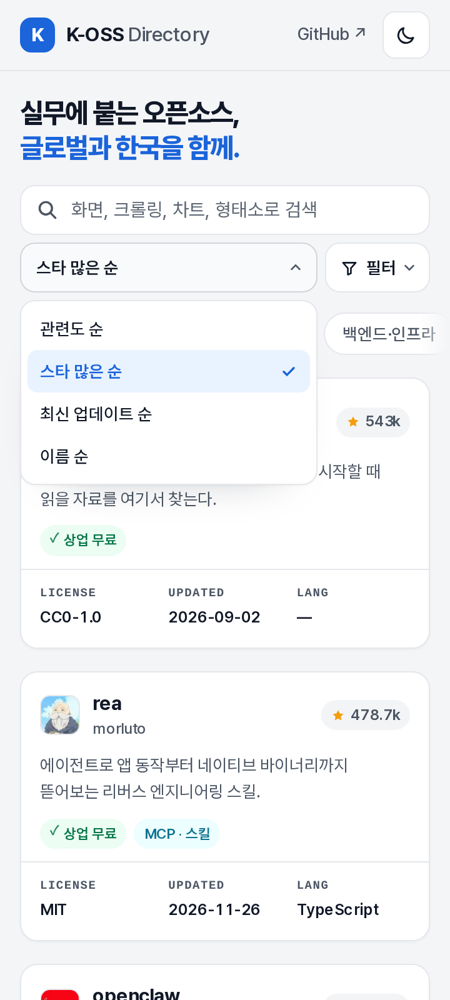
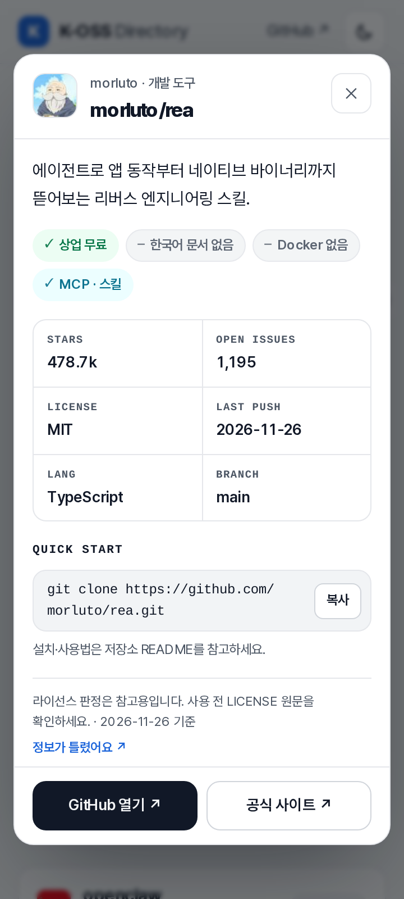

# K-OSS Directory

**🔗 라이브 사이트 — [k-oss-directory.pages.dev](https://k-oss-directory.pages.dev)**

**실무에 붙는 오픈소스, 글로벌과 한국을 한 화면에서.**

GitHub Explore는 트렌딩만 보여주고, 쓸 만한 프로젝트는 언어 장벽·라이선스 불안·실행 장벽·관리 중단 때문에 매번 검색에서 걸러집니다.
K-OSS Directory는 **해외 인디 개발자·소규모 팀의 프로젝트와 한국 팀·개인 개발자의 저장소**를 같은 기준으로 모아, 실무에 바로 붙일 수 있는지 다섯 가지 기준으로 판정해 카드 한 장에 보여줍니다.

## 이렇게 판정합니다

- 🌍 **글로벌 + 한국** — 해외 개인·소규모 팀이 만든 실무 오픈소스와 한국 팀·기업·개인 개발자 저장소를 함께, 사람이 검수해 넣습니다.
- 📘 **한국어 문서** — `README.ko.md` 같은 번역본 존재 여부와 README 한글 비중으로 자동 판정합니다.
- ⚖️ **상업 무료 라이선스** — MIT·Apache-2.0·BSD·ISC·MPL-2.0·OFL-1.1 등 SPDX 허용 목록과 대조합니다. AGPL·SSPL·사용 제한 라이선스는 넣지 않습니다.
- 🐳 **Docker 실행** — 루트 `Dockerfile`·공식 이미지 여부를 확인하고, `최근 3개월` 푸시 필터를 함께 제공합니다.
- 🧩 **MCP · 스킬** — MCP 서버·클라이언트(`mcp`·`mcp-server`·`model-context-protocol` 토픽, 이름이 `-mcp`로 끝나는 저장소)와 코딩 에이전트용 스킬·플러그인(`agent-skills`·`claude-code-plugin` 같은 토픽, 소개·설명의 'Claude Code 플러그인')을 한 칩으로 골라 봅니다. 플러그인 구조를 쓰는 일반 프레임워크(oh-my-zsh·eslint·stackflow)와 MCP를 설치 수단으로만 언급하는 도구는 넣지 않습니다.

화면에서는 이 다섯 가지를 카드 한 장에 담고, 검색·카테고리·필터·정렬이 즉시 반영됩니다. 목록은 **24개씩 먼저 보여 주고 `더 보기 (N개 남음)` 버튼으로 이어서 펼칩니다**. 검색은 한·영 유의어 사전과 BM25 관련도 점수로 돌아갑니다. `화면`이라고만 쳐도 `ui`·`ux`·`컴포넌트`·`프론트엔드` 항목이 관련도 순으로 올라오고, `-`·`_`·`/`·공백을 모두 구분자로 봐서 `k-ui-ux`를 쳐도 `k-style-ui-ux`가 바로 나옵니다. 카드마다 `git clone` 명령을 복사할 수 있고, 라이트/다크 모드 선택은 `localStorage`에 남습니다. 모바일 360px에서도 상세 모달은 헤더·하단 버튼이 고정되고 본문만 스크롤되어 `GitHub 열기`가 가려지지 않습니다. 본문 글꼴은 Pretendard이고, 본문 대비는 라이트·다크 모두 4.5:1 이상입니다.

<p>
  
</p>
<p>
  
  
</p>
<p>
  
  
  
</p>
<p>
  
</p>

## 수록 현황

**1,321개 저장소** — 전부 상업 무료 라이선스입니다. 한국어 문서 91 · Docker 225 · 최근 3개월 푸시 905 · MCP·스킬 178 · 보관됨 3 (2026-11-26 GitHub API 검증).

| 분류 | 프론트엔드 | AI·데이터 | 백엔드·인프라 | 개발 도구 | 학습·자료 | 합계 |
|---|---|---|---|---|---|---|
| 저장소 | 112 | 284 | 137 | 701 | 87 | 1,321 |

### 어디서 모았나

| 출처 | 후보 | 검증 통과 | 실제 수록 | 기준 |
|---|---|---|---|---|
| 기존 큐레이션(한국 팀·글로벌 인디) | — | — | 520 | 사람이 직접 검수 |
| GitHub 별표 `YunhuPark` | 1,211 | 719 | 719 | 보관 아님 + 상업 무료 라이선스, 기존 수록분 36개·비상업 라이선스·보관 저장소 제외 |
| Hacker News Show HN | Algolia API 글 3,500여 건에서 GitHub URL 1,023개 | 578 | 336 | `gh api repos/{owner}/{repo}`로 존재·비보관·상업 무료 확인 후, **스타 100+ & 최근 3년 푸시**인 인디·메이커 프로젝트 |
| Lobsters (show/hottest) | 50 | 9 | 6 | 위와 같은 기준 |
| GeekNews RSS | 최근 20건 | 0 | 0 | 이미 수록·검증된 저장소뿐이라 추가 없음 |
| Reddit (`r/opensource` 등) | — | — | 0 | 네트워크에서 403(You've been blocked by network security)으로 접근 불가 — 다음에 다시 시도 |

별표에서 뺀 것: 보관(archived) 52개, AGPL·GPL·SSPL·NOASSERTION 등 비상업/불명 라이선스 430개, 이미 수록된 36개.
커뮤니티에서 뺀 것: 존재하지 않음 15개, 보관 21개, 비상업 라이선스 283개, 확인 실패 95개, 스타 100 미만 또는 3년 이상 방치 245개.
별점·최근 푸시 같은 수치는 `public/data/catalog.json`이 매일 갱신하므로, 최신 값은 사이트에서 보는 편이 정확합니다.

<details>
<summary>스타 상위 25개 (2026-11-26 기준)</summary>

| 저장소 | 만든 곳 | 분류 | ★ | 라이선스 | 한국어 문서 |
|---|---|---|---|---|---|
| [sindresorhus/awesome](https://github.com/sindresorhus/awesome) | Sindre Sorhus | 학습·자료 | 543k | CC0-1.0 |   |
| [morluto/rea](https://github.com/morluto/rea) | morluto | 개발 도구 | 478.7k | MIT |   |
| [openclaw/openclaw](https://github.com/openclaw/openclaw) | openclaw | AI·데이터 | 395.2k | MIT |   |
| [mattpocock/skills](https://github.com/mattpocock/skills) | mattpocock | 개발 도구 | 333k | MIT |   |
| [obra/superpowers](https://github.com/obra/superpowers) | obra | 개발 도구 | 326.8k | MIT |   |
| [affaan-m/ECC](https://github.com/affaan-m/ECC) | affaan-m | 개발 도구 | 310.8k | MIT |   |
| [practical-tutorials/project-based-learning](https://github.com/practical-tutorials/project-based-learning) | practical-tutorials | 학습·자료 | 290.5k | MIT |   |
| [deepseek-ai/deepseek-harness](https://github.com/deepseek-ai/deepseek-harness) | 딥시크 | 개발 도구 | 287.2k | MIT |   |
| [NousResearch/hermes-agent](https://github.com/NousResearch/hermes-agent) | NousResearch | AI·데이터 | 266.2k | MIT |   |
| [trimstray/the-book-of-secret-knowledge](https://github.com/trimstray/the-book-of-secret-knowledge) | trimstray | 학습·자료 | 261.4k | MIT |   |
| [TheAlgorithms/Python](https://github.com/TheAlgorithms/Python) | TheAlgorithms | 학습·자료 | 226.5k | MIT |   |
| [ossu/computer-science](https://github.com/ossu/computer-science) | OSSU | 학습·자료 | 211.6k | MIT |   |
| [yt-dlp/yt-dlp](https://github.com/yt-dlp/yt-dlp) | yt-dlp | 개발 도구 | 210.8k | Unlicense |   |
| [DietrichGebert/ponytail](https://github.com/DietrichGebert/ponytail) | DietrichGebert | 개발 도구 | 198.8k | MIT |   |
| [microsoft/markitdown](https://github.com/microsoft/markitdown) | Microsoft | AI·데이터 | 198.5k | MIT |   |
| [trekhleb/javascript-algorithms](https://github.com/trekhleb/javascript-algorithms) | Oleksii Trekhleb | 학습·자료 | 196.8k | MIT | ✅ |
| [avelino/awesome-go](https://github.com/avelino/awesome-go) | avelino | 학습·자료 | 196k | MIT |   |
| [ohmyzsh/ohmyzsh](https://github.com/ohmyzsh/ohmyzsh) | ohmyzsh | 개발 도구 | 190.9k | MIT |   |
| [ollama/ollama](https://github.com/ollama/ollama) | Ollama | AI·데이터 | 188.2k | MIT |   |
| [msitarzewski/agency-agents](https://github.com/msitarzewski/agency-agents) | msitarzewski | AI·데이터 | 170.3k | MIT |   |
| [huggingface/transformers](https://github.com/huggingface/transformers) | Hugging Face | AI·데이터 | 169.3k | Apache-2.0 |   |
| [langflow-ai/langflow](https://github.com/langflow-ai/langflow) | langflow-ai | AI·데이터 | 157k | MIT |   |
| [nextlevelbuilder/ui-ux-pro-max-skill](https://github.com/nextlevelbuilder/ui-ux-pro-max-skill) | nextlevelbuilder | 개발 도구 | 154.3k | MIT | ✅ |
| [Graphify-Labs/graphify](https://github.com/Graphify-Labs/graphify) | Graphify-Labs | 개발 도구 | 153.5k | Apache-2.0 |   |
| [github/spec-kit](https://github.com/github/spec-kit) | github | 개발 도구 | 151.4k | MIT | ✅ |

</details>

## 저장소 구조

```
data/repos.json              # 사람이 관리하는 큐레이션 원본 (무엇을 넣을지·분류·한 줄 소개)
public/                      # 배포되는 정적 사이트 (빌드 없음)
  index.html · styles.css · app.js
  lib/filter.mjs             # 유의어 사전·BM25 검색·필터·정렬·페이지 나누기 (브라우저와 테스트가 함께 사용)
  data/catalog.json          # 스크립트가 만드는 생성물 (스타·라이선스·최근 푸시·판정)
scripts/
  sync_repos.mjs             # GITHUB_TOKEN으로 catalog.json 생성 (CI)
  seed_from_gh.mjs           # gh CLI로 catalog.json 생성 (로컬, 토큰 불필요)
  serve.mjs                  # 로컬 미리보기 서버
  ui_check.mjs               # 360/1280 헤드리스 브라우저 검증 + 스크린샷
  tests/                     # node --test 단위 테스트
docs/workflows/sync.yml      # 일일 동기화 워크플로 (.github/workflows로 옮기면 활성화)
.github/ISSUE_TEMPLATE/submit-repo.yml   # 저장소 제보 폼
PRD.md                       # 기획서 (화면·데이터 모델·아키텍처·로드맵)
```

**운영비 0원** — 서버도 DB도 없습니다. 정적 파일 + GitHub Actions(하루 1회) + Cloudflare Pages 무료 플랜.

## 로컬에서 실행

Node 22 이상이면 됩니다. 설치할 패키지는 없습니다.

```bash
node scripts/serve.mjs                  # → http://localhost:4173
node --test scripts/tests/*.test.mjs    # 단위 테스트
```

`public/data/catalog.json`이 저장소에 포함되어 있어 바로 뜹니다. 데이터를 새로 받고 싶다면 (`gh` 로그인 상태에서):

```bash
node scripts/seed_from_gh.mjs
```

## 저장소 추가·수정

1. `data/repos.json`의 `repos` 배열에 항목을 추가합니다.

   ```jsonc
   {
     "repo": "owner/name",          // 필수
     "vendor": "만든 곳",            // 표시용 (조직·개인·제품 이름)
     "category": "frontend",        // frontend | ai | backend | tool | learn
     "summary": "한 줄 소개",         // 한국어로 직접 씁니다
     "tags": ["React", "모달"],
     "koreanDocs": true,            // 선택: 자동 판정을 덮어쓸 때만
     "docker": true,                // 선택: Dockerfile/이미지를 직접 확인했을 때만
     "mcpSkill": false,             // 선택: MCP·스킬 자동 판별을 뒤집어야 할 때만
     "addedAt": "2026-11-26"
   }
   ```

2. `node scripts/seed_from_gh.mjs`로 `catalog.json`을 갱신합니다(또는 Actions 실행).
3. PR을 올리면 검토 후 반영됩니다. 저장소를 직접 고치기 어렵다면 [제보 이슈](../../issues/new?template=submit-repo.yml)로 알려 주세요.

**수록 기준** — ① 해외 인디 개발자·소규모 팀 또는 한국 팀·기업·개인 개발자가 만든 공개 저장소 ② 지금 실무에 쓸 수 있는 것(보관(archived) 상태이거나 3년 이상 방치 + 대체재가 있으면 제외) ③ 상업 무료 라이선스가 명시된 것.

## 판정 규칙 상세

| 판정 | 방법 |
|---|---|
| 상업 무료 | SPDX가 MIT·Apache-2.0·BSD-2/3-Clause·ISC·MPL-2.0·CC0-1.0·Unlicense·0BSD·OFL-1.1 중 하나. GitHub이 라이선스를 못 읽는 저장소는 `license`에 사람이 확인한 값을 적는다(`licenseSource: curated`) |
| 한국어 문서 | `koreanDocs` 수동 값 → `README.ko.md`류 파일 → README 한글 100자 이상 순서로 판정 |
| Docker | `docker` 수동 값 → 루트 `Dockerfile` → topics에 `docker` |
| MCP · 스킬 | 태그·토픽을 낱말 단위로 본다: `mcp`·`mcp-server`·`mcp-client`·`model-context-protocol`, `-mcp`로 끝나는 이름, `agent-skills`·`claude-skill`·`claude-code-plugin`(플러그인은 claude·codex·skill과 붙어 있을 때만), 소개·원문 설명의 `에이전트 스킬`·`Claude Code 플러그인` 같은 표현. 데이터에 `mcpSkill` 값을 직접 적으면 그 값이 우선한다 |
| 최근 3개월 | `pushed_at`이 동기화 시점 −90일 이후 |

## 검색 규칙

서버·API 없이 브라우저에서만 돕니다. `public/lib/filter.mjs` 하나를 사이트와 테스트가 함께 씁니다.

1. **한·영 유의어 확장** — 58묶음·468낱말 사전으로 검색어를 넓힙니다. `화면` → `ui`·`ux`·`screen`·`레이아웃`·`컴포넌트`·`프론트엔드`, `크롤링` → `스크래핑`·`파싱`·`봇`, `문서` → `pdf`·`hwp`·`마크다운`, `ai` → `llm`·`에이전트`·`rag`·`mcp`, `배포` → `도커`·`컨테이너`·`ci`·`클라우드` 같이 이어집니다.
2. **BM25 채점** — 정확 일치 1.0, 유의어 0.5 가중치에 IDF·문서 길이 정규화(k1=1.2, b=0.75)를 적용합니다. 필드 가중치는 `이름` 10 > `저장소 경로` 8 > `태그` 5 > `분류` 4 > `토픽·만든 곳·소개` 3 > `원문 설명` 2 > `언어` 1.5 순입니다.
3. **정렬** — 검색어가 있으면 관련도 순(같으면 스타 많은 순), 지우면 스타순으로 돌아갑니다. 이름순·업데이트순을 직접 고르면 그 기준을 지킵니다.

| 입력 | 동작 |
|---|---|
| `화면` | 유의어로 `ui`·`ux`·`컴포넌트`·`프론트엔드` 항목까지 관련도 순으로 |
| `크롤링` | `scrapy`처럼 `scraping`·`crawler`만 쓰는 저장소도 찾는다 |
| `k-ui-ux` | `-`·`_`·`/`·공백을 구분자로 나눠 `k`·`ui`·`ux`를 모두 포함하는 항목 → `k-style-ui-ux`가 바로 나온다 |
| `react 쿼리` | 두 토큰을 모두 포함(AND). 각 토큰은 유의어로 걸려도 된다 |
| `차트` | 한글은 조사가 붙어도 찾는다(`차트가`, `차트를` 모두 매칭) |
| `k` · `ui` (1~2자 영문) | 낱말 경계에서만 맞춘다. `unsloth` 속 글자에 걸리지 않는다 |
| 대상 | 저장소 경로·이름·만든 곳·소개·원문 설명·태그·분류·토픽·언어 |

## 페이지 나누기

- 처음에는 **24개**만 그립니다(`PAGE_SIZE`).
- 남은 항목이 있으면 목록 아래에 `더 보기 (N개 남음)` 버튼이 붙고, 누를 때마다 24개씩 이어서 그립니다.
- 검색어·카테고리·필터·정렬이 바뀌면 다시 24개부터 보여 줍니다(URL 해시도 함께 갱신).

## 카드 아바타

- 카드마다 만든 곳의 GitHub 프로필 그림(`https://github.com/{owner}.png?size=64`)을 32px 타일에 얹고, 그림이 오기 전·실패 시에는 이니셜(S·M·O)을 보여 줍니다.
- 그림은 화면 근처(±400px)에 온 타일만 받고, 한 번 받은 뒤에는 그대로 둡니다. 요청은 한 번에 6장까지만 보냅니다 — 1,321개 카드가 한꺼번에 요청해 브라우저가 자원 고갈(`ERR_INSUFFICIENT_RESOURCES`)로 터지는 것을 막습니다.

## 검증

- **단위 테스트 57개** (`scripts/tests/`) — 라이선스 판정(OFL-1.1·직접 확인 값 포함), 한국어/Docker 판정, 말일 보정, 실패 시 직전 값 유지, 스키마 검증, **유의어 검색(`화면` → UI·프론트엔드)**, **BM25 필드 가중치·관련도 정렬**, 토큰 검색(`k-ui-ux` → `k-style-ui-ux`), 24개 페이지 나누기, 검색·필터·정렬, **MCP·스킬 판별(토픽·이름·소개 문구, 일반 플러그인 프레임워크 제외, `mcpSkill` 수동 값 우선)**, **수록 데이터 불변식(1,300개 이상·중복 0·전부 상업 무료·별표 719개 포함)**
- **헤드리스 브라우저 180개 항목** — 360px·1280px, 라이트·다크에서 첫 화면 구성(제목 → 검색 → 정렬·필터 → 카테고리 → 카드), **첫 화면 24개 렌더 · `더 보기` 1회 48개 · 끝까지 눌러 전체 1,321개 · 버튼 숨김**, **첫 화면·스크롤한 카드의 GitHub 아바타 실제 로드(`img.complete && naturalWidth > 0`)**, **1,321개를 펼쳐도 이미지 요청 실패 0**, **`화면` 검색이 UI·프론트엔드 항목을 관련도 순으로 표시**, **`k-ui-ux` 검색이 `k-style-ui-ux`를 표시**, **`MCP · 스킬` 칩(178개 중 24개·카드 배지·`#f=mcp` 해시 복원·`한국어 문서`와 AND)**, **정렬 커스텀 드롭다운(열기·선택·화살표/Escape/바깥 클릭·해시 복원)**, **글자에 맞춘 칩 폭과 카드 높이 균일**, **상세 모달(README 한 줄·OPEN ISSUES 천 단위 쉼표·`MCP · 스킬` 배지·공식 사이트/README 버튼·모바일에서 `GitHub 열기` 고정)**, 푸터 수록 현황 한 줄, 세부 필터 접힘/펼침, 카테고리 필 칩, 가로 넘침 0, 검색·필터 AND·정렬, 테마 토글·저장, 대비 4.5:1, 해시 복원, 키보드 조작, 콘솔 오류 0, 접근성 이름·터치 타깃

```bash
node --test scripts/tests/*.test.mjs
PUPPETEER_PATH=/path/to/puppeteer node scripts/ui_check.mjs --out downloads/k-oss-mvp
```

## 배포 (Cloudflare Pages)

1. Cloudflare Pages → *Create a project* → GitHub 저장소 연결
2. **Build command: (없음)** · **Build output directory: `public`**
3. 커밋마다 자동 배포. `data/repos.json`을 고치고 동기화가 돌면 사이트가 갱신됩니다.

## 자동 동기화 켜기

GitHub App 권한 제한으로 워크플로 파일은 `docs/workflows/sync.yml`에 있습니다. 소유자가 GitHub 웹에서 `.github/workflows/sync.yml` 파일을 만들어 내용을 붙여넣으면 매일 06:00 KST에 자동 실행됩니다. Actions 탭 → **저장소 메타데이터 동기화** → *Run workflow* 로 즉시 1회 실행할 수 있습니다.

동기화는 실패에 강합니다.

- 한 저장소가 실패해도 나머지는 갱신하고, 실패한 항목은 **직전 값 유지**
- 전부 실패하면 기존 `catalog.json`을 **덮어쓰지 않고** 워크플로만 실패 (사이트는 계속 동작)
- 파일을 쓰기 전에 스키마를 검증 (`assertCatalog`)

## 로드맵

- [x] 시드 40개로 확장 (국내 19개 + OFL 폰트 2개 + 별표 저장소 4개, 2026-11-26)
- [x] 93개로 대량 확장 (국내 기업·팀 15곳 38개 + 개인·커뮤니티 15개, 2026-11-26)
- [x] 260개로 확장 + 24개 `더 보기` + 토큰 검색 (글로벌 인디·실무 133개, 국내 인디·개인 34개, 2026-11-26)
- [x] 별표 1,211개 + 커뮤니티(Show HN·Lobsters) 확장으로 260개 → 1,321개, 한·영 유의어 + BM25 검색 (2026-11-26)
- [ ] 태그 클릭 탐색, 상세 정적 페이지(`/r/{owner}/{repo}`), OG 이미지
- [ ] 주간 인기순 (스타 증가량 스냅샷)

## 라이선스

**아직 정하지 않았습니다.** 공개 저장소로 운영하려면 라이선스(예: MIT)를 정해 `LICENSE` 파일을 추가해야 합니다. `public/`의 코드와 `data/repos.json`의 큐레이션 목록은 별도로 정할 수 있습니다.
