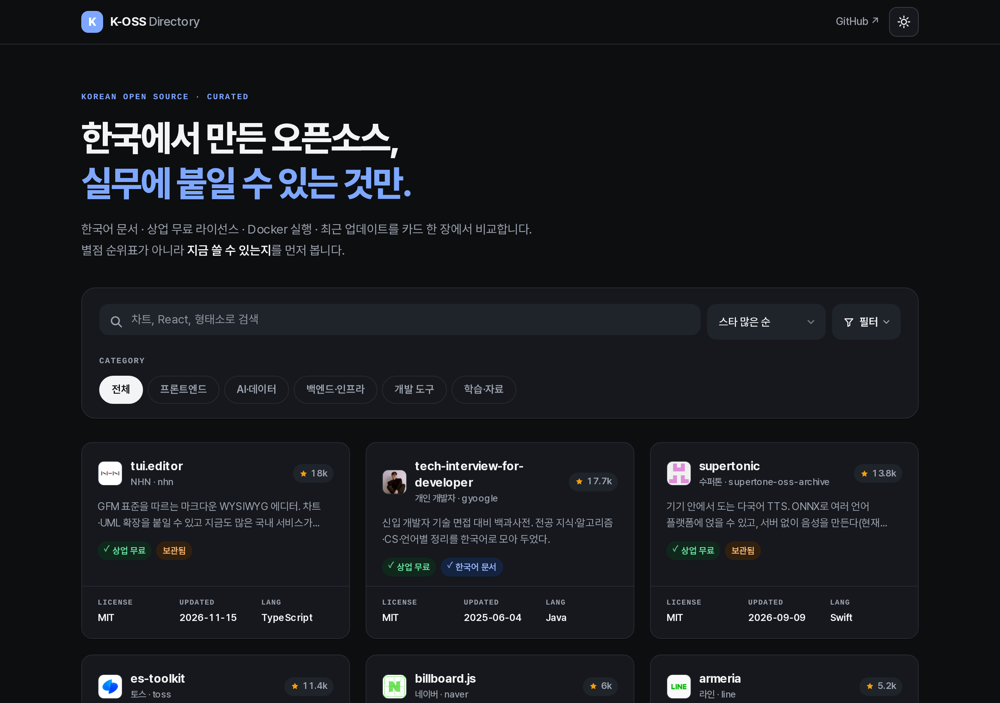
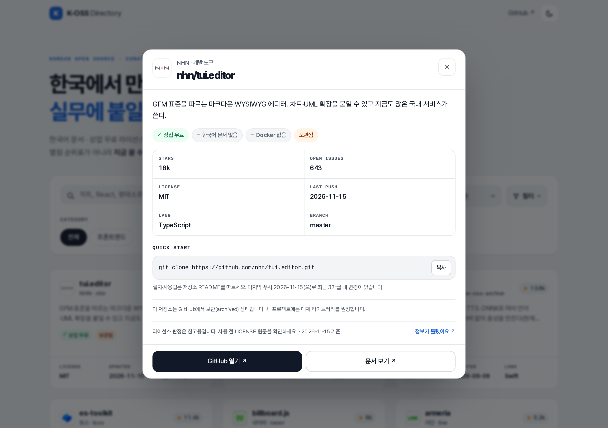

# K-OSS Directory

**한국 개발자가 만든, 한국어로 쓸 수 있는 오픈소스를 한 화면에서.**

GitHub Explore는 트렌딩만 보여주고, 국산 오픈소스는 언어 장벽·라이선스 불안·실행 장벽·관리 중단 때문에 매번 검색에서 걸러집니다.
K-OSS Directory는 **한국 팀·기업·개인 개발자의 저장소만** 모아, 실무에 바로 붙일 수 있는지 네 가지로 판정해 카드 한 장에 보여줍니다.

- 🇰🇷 **국산 한정** — 사람이 검수한 목록
- 📘 **한국어 문서 여부** — README 한글 비중·`README.ko.md` 존재를 자동 판정
- ⚖️ **상업 무료 라이선스** — SPDX 허용 목록(MIT·Apache-2.0·BSD·ISC·MPL-2.0·OFL-1.1 등) 대조
- 🐳 **Docker 실행** — Dockerfile·공식 이미지 확인 + `최근 3개월` 필터
- 🌗 **라이트/다크 모드** — 헤더의 토글 버튼, 선택은 `localStorage`에 저장
- 📱 **모바일에서도 잘리지 않는 상세 모달** — 헤더·하단 버튼은 고정, 본문만 스크롤(360px에서 `GitHub 열기`가 항상 보임)
- 📐 **첫 화면은 여백부터** — 숫자판·안내 줄 없이 **제목 → 검색 → 정렬·필터 → 카테고리 → 카드** 다섯 덩어리만 두고, 헤더·제목·검색·카드 사이 여백을 넓혀 360px에서도 카드 2장이 시원하게 보인다(수록 현황은 푸터 한 줄)
- 🏷️ **카테고리 개별 필 칩** — 배경 트랙 없이 칩만 두어 `전체`가 한쪽에 붙어 보이지 않고, 넘칠 때는 좌우 페이드 + 가로 스크롤
- 🔤 **Pretendard + 선명한 대비** — 본문 `#111827`/보조 `#4B5563`(다크 `#F3F4F6`/`#9CA3AF`), 카드에 32px GitHub 아바타와 `git clone` 복사 버튼

<p>
  
</p>
<p>
  
</p>
<p>
  
  
</p>

## 지금 수록된 저장소 (93개, 2026-11-26 GitHub API로 검증)

이번 배치(2026-11-26)에서 한 일:

- 국내 기업·팀 조직 15곳(토스·네이버·카카오·카카오뱅크·라인·당근·우아한테크코스·스포카·하이퍼커넥트·엔씨소프트·데브시스터즈·뱅크샐러드·SK텔레콤·야놀자·리디)의 공개 저장소를 실측 조회해 38개를 추가했습니다.
- 한국어 생태계 개인·커뮤니티 저장소(한글 처리·형태소 분석·공문서·공휴일·한국어 학습 자료) 15개를 더했습니다.
- 40개 → **93개**. 추가한 53개 모두 `gh api repos/{owner}/{repo}`로 존재·아카이브 아님·상업 무료 라이선스를 다시 확인했습니다.

| 저장소 | 만든 곳 | 분류 | ★ | 라이선스 | 한국어 문서 |
|---|---|---|---|---|---|
| [nhn/tui.editor](https://github.com/nhn/tui.editor) | NHN | 개발 도구 | 18k | MIT | 보관됨 |
| [gyoogle/tech-interview-for-developer](https://github.com/gyoogle/tech-interview-for-developer) | 개인 개발자 | 학습·자료 | 17.7k | MIT | ✅ |
| [supertone-oss-archive/supertonic](https://github.com/supertone-oss-archive/supertonic) | 수퍼톤 | AI·데이터 | 13.8k | MIT | 보관됨 |
| [toss/es-toolkit](https://github.com/toss/es-toolkit) | 토스 | 프론트엔드 | 11.4k | MIT | ✅ |
| [naver/billboard.js](https://github.com/naver/billboard.js) | 네이버 | 프론트엔드 | 6k | MIT |  |
| [line/armeria](https://github.com/line/armeria) | 라인 | 백엔드·인프라 | 5.2k | Apache-2.0 |  |
| [orioncactus/pretendard](https://github.com/orioncactus/pretendard) | 개인 개발자 | 프론트엔드 | 3.7k | OFL-1.1 | ✅ |
| [yybmion/public-apis-4Kr](https://github.com/yybmion/public-apis-4Kr) | 개인 개발자 | 학습·자료 | 3.6k | MIT | ✅ |
| [chrisryugj/kordoc](https://github.com/chrisryugj/kordoc) | 개인 개발자 | 개발 도구 | 3.1k | MIT | ✅ |
| [chrisryugj/korean-law-mcp](https://github.com/chrisryugj/korean-law-mcp) | 개인 개발자 | AI·데이터 | 2.9k | MIT | ✅ |
| [naver/egjs-flicking](https://github.com/naver/egjs-flicking) | 네이버 | 프론트엔드 | 2.9k | MIT |  |
| [naver/egjs-infinitegrid](https://github.com/naver/egjs-infinitegrid) | 네이버 | 프론트엔드 | 2.4k | MIT |  |
| [jo-duchan/tapflow](https://github.com/jo-duchan/tapflow) | 개인 개발자 | 개발 도구 | 2.3k | MIT |  |
| [naver/d2-coding-font](https://github.com/naver/d2-coding-font) | 네이버 | 프론트엔드 | 2.3k | OFL-1.1 |  |
| [line/line-bot-sdk-python](https://github.com/line/line-bot-sdk-python) | 라인 | 백엔드·인프라 | 2.1k | Apache-2.0 |  |
| [teddylee777/langchain-kr](https://github.com/teddylee777/langchain-kr) | 개인 개발자 | 학습·자료 | 2.1k | Apache-2.0 | ✅ |
| [toss/frontend-fundamentals](https://github.com/toss/frontend-fundamentals) | 토스 | 학습·자료 | 2k | MIT |  |
| [toss/es-hangul](https://github.com/toss/es-hangul) | 토스 | 프론트엔드 | 1.9k | MIT | ✅ |
| [kakao/khaiii](https://github.com/kakao/khaiii) | 카카오 | AI·데이터 | 1.5k | Apache-2.0 | ✅ |
| [kakaobrain/pororo](https://github.com/kakaobrain/pororo) | 카카오브레인 | AI·데이터 | 1.3k | Apache-2.0 | ✅ 보관됨 |
| [daangn/seed-design](https://github.com/daangn/seed-design) | 당근 | 프론트엔드 | 1.2k | Apache-2.0 | ✅ |
| [line/promgen](https://github.com/line/promgen) | 라인 | 백엔드·인프라 | 1.1k | MIT |  |
| [line/line-bot-sdk-nodejs](https://github.com/line/line-bot-sdk-nodejs) | 라인 | 백엔드·인프라 | 1.1k | Apache-2.0 |  |
| [toss/suspensive](https://github.com/toss/suspensive) | 토스 | 프론트엔드 | 1.1k | MIT |  |
| [daangn/stackflow](https://github.com/daangn/stackflow) | 당근 | 프론트엔드 | 1k | MIT |  |
| [woowacourse/back-end-roadmap](https://github.com/woowacourse/back-end-roadmap) | 우아한테크코스 | 학습·자료 | 990 | MIT | ✅ |
| [line/kotlin-jdsl](https://github.com/line/kotlin-jdsl) | 라인 | 백엔드·인프라 | 826 | Apache-2.0 |  |
| [bab2min/Kiwi](https://github.com/bab2min/Kiwi) | 개인 개발자 | AI·데이터 | 811 | Apache-2.0 | ✅ |
| [line/line-bot-mcp-server](https://github.com/line/line-bot-mcp-server) | 라인 | AI·데이터 | 806 | Apache-2.0 |  |
| [amondnet/vercel-action](https://github.com/amondnet/vercel-action) | 개인 개발자 | 개발 도구 | 764 | MIT |  |
| [toss/overlay-kit](https://github.com/toss/overlay-kit) | 토스 | 프론트엔드 | 739 | MIT | ✅ |
| [e-/Hangul.js](https://github.com/e-/Hangul.js) | 개인 개발자 | 프론트엔드 | 709 | MIT | ✅ |
| [naver/fixture-monkey](https://github.com/naver/fixture-monkey) | 네이버 | 개발 도구 | 697 | Apache-2.0 | ✅ |
| [line/centraldogma](https://github.com/line/centraldogma) | 라인 | 백엔드·인프라 | 675 | Apache-2.0 |  |
| [open-korean-text/open-korean-text](https://github.com/open-korean-text/open-korean-text) | 커뮤니티 | AI·데이터 | 667 | Apache-2.0 | ✅ |
| [line/line-fido2-server](https://github.com/line/line-fido2-server) | 라인 | 백엔드·인프라 | 587 | Apache-2.0 |  |
| [toss/use-funnel](https://github.com/toss/use-funnel) | 토스 | 프론트엔드 | 586 | MIT |  |
| [kakao/n2](https://github.com/kakao/n2) | 카카오 | AI·데이터 | 581 | Apache-2.0 |  |
| [kakao/buffalo](https://github.com/kakao/buffalo) | 카카오 | AI·데이터 | 578 | Apache-2.0 |  |
| [naver/kapture](https://github.com/naver/kapture) | 네이버 | AI·데이터 | 546 | BSD-3-Clause |  |
| [hyunbinseo/holidays-kr](https://github.com/hyunbinseo/holidays-kr) | 개인 개발자 | 개발 도구 | 515 | MIT | ✅ |
| [woowacourse/tecoble](https://github.com/woowacourse/tecoble) | 우아한테크코스 | 학습·자료 | 491 | MIT |  |
| [toss/granite](https://github.com/toss/granite) | 토스 | 프론트엔드 | 481 | Apache-2.0 | ✅ |
| [naver/scavenger](https://github.com/naver/scavenger) | 네이버 | 개발 도구 | 467 | Apache-2.0 |  |
| [devsisters/shardcake](https://github.com/devsisters/shardcake) | 데브시스터즈 | 백엔드·인프라 | 449 | Apache-2.0 |  |
| [vmc-inner-circle/k-style-ui-ux](https://github.com/vmc-inner-circle/k-style-ui-ux) | VMC 이너서클 | 개발 도구 | 418 | MIT | ✅ |
| [spoqa/spoqa-han-sans](https://github.com/spoqa/spoqa-han-sans) | 스포카 | 프론트엔드 | 412 | OFL-1.1 | ✅ |
| [line/abc-user-feedback](https://github.com/line/abc-user-feedback) | 라인 | 개발 도구 | 381 | Apache-2.0 |  |
| [golangkorea/effective-go](https://github.com/golangkorea/effective-go) | Golang Korea | 학습·자료 | 380 | Apache-2.0 | ✅ |
| [PyTorchKR/tutorials-kr](https://github.com/PyTorchKR/tutorials-kr) | PyTorch 한국 사용자 모임 | 학습·자료 | 375 | BSD-3-Clause | ✅ |
| [line/decaton](https://github.com/line/decaton) | 라인 | 백엔드·인프라 | 373 | Apache-2.0 |  |
| [line/garr](https://github.com/line/garr) | 라인 | 백엔드·인프라 | 372 | Apache-2.0 |  |
| [toss/react-simplikit](https://github.com/toss/react-simplikit) | 토스 | 프론트엔드 | 361 | MIT | ✅ |
| [samchon/payments](https://github.com/samchon/payments) | 개인 개발자 | 백엔드·인프라 | 359 | MIT | ✅ |
| [toss/es-git](https://github.com/toss/es-git) | 토스 | 개발 도구 | 333 | MIT | ✅ |
| [toss/h6s](https://github.com/toss/h6s) | 토스 | 개발 도구 | 319 | MIT | ✅ |
| [naver/arcus](https://github.com/naver/arcus) | 네이버 | 백엔드·인프라 | 317 | Apache-2.0 |  |
| [naver/spring-jdbc-plus](https://github.com/naver/spring-jdbc-plus) | 네이버 | 백엔드·인프라 | 293 | Apache-2.0 |  |
| [toss/nestjs-aop](https://github.com/toss/nestjs-aop) | 토스 | 개발 도구 | 257 | MIT | ✅ |
| [line/apng-drawable](https://github.com/line/apng-drawable) | 라인 | 프론트엔드 | 255 | Apache-2.0 |  |
| [hangulize/hangulize](https://github.com/hangulize/hangulize) | 개인 개발자 | 개발 도구 | 251 | MIT | ✅ |
| [bluewings/korean-regexp](https://github.com/bluewings/korean-regexp) | 개인 개발자 | 프론트엔드 | 231 | MIT | ✅ |
| [kakao/actionbase](https://github.com/kakao/actionbase) | 카카오 | 백엔드·인프라 | 230 | Apache-2.0 |  |
| [daangn/autopprof](https://github.com/daangn/autopprof) | 당근 | 백엔드·인프라 | 221 | Apache-2.0 |  |
| [naver/pr-stats](https://github.com/naver/pr-stats) | 네이버 | 개발 도구 | 203 | Apache-2.0 | ✅ |
| [woowacourse/prolog](https://github.com/woowacourse/prolog) | 우아한테크코스 | 학습·자료 | 201 | MIT |  |
| [toss/apps-in-toss-harness](https://github.com/toss/apps-in-toss-harness) | 토스 | 개발 도구 | 194 | BSD-3-Clause | ✅ |
| [kakao/kakao_flutter_sdk](https://github.com/kakao/kakao_flutter_sdk) | 카카오 | 개발 도구 | 194 | Apache-2.0 |  |
| [Indosaram/hwpers](https://github.com/Indosaram/hwpers) | 개인 개발자 | 개발 도구 | 191 | MIT |  |
| [naver/egjs-axes](https://github.com/naver/egjs-axes) | 네이버 | 프론트엔드 | 190 | MIT |  |
| [ongjin/garu](https://github.com/ongjin/garu) | 개인 개발자 | AI·데이터 | 183 | Apache-2.0 | ✅ |
| [ncsoft/CaPa](https://github.com/ncsoft/CaPa) | 엔씨소프트 | AI·데이터 | 165 | BSD-3-Clause |  |
| [kakao/web2app](https://github.com/kakao/web2app) | 카카오 | 프론트엔드 | 164 | MIT |  |
| [hyperconnect/HypeUI](https://github.com/hyperconnect/HypeUI) | 하이퍼커넥트 | 프론트엔드 | 149 | Apache-2.0 |  |
| [daangn/KarrotListKit](https://github.com/daangn/KarrotListKit) | 당근 | 프론트엔드 | 146 | Apache-2.0 |  |
| [naver/spring-batch-plus](https://github.com/naver/spring-batch-plus) | 네이버 | 백엔드·인프라 | 130 | Apache-2.0 |  |
| [kakao/prevue](https://github.com/kakao/prevue) | 카카오 | 개발 도구 | 127 | Apache-2.0 | ✅ |
| [naver/egjs-conveyer](https://github.com/naver/egjs-conveyer) | 네이버 | 프론트엔드 | 126 | MIT |  |
| [kakaobank/KF-DeBERTa](https://github.com/kakaobank/KF-DeBERTa) | 카카오뱅크 | AI·데이터 | 123 | MIT | ✅ |
| [naver/cfcs](https://github.com/naver/cfcs) | 네이버 | 프론트엔드 | 119 | MIT |  |
| [banksalad/AXSnapshot](https://github.com/banksalad/AXSnapshot) | 뱅크샐러드 | 개발 도구 | 113 | MIT | ✅ |
| [toss/docflow](https://github.com/toss/docflow) | 토스 | 개발 도구 | 106 | MIT | ✅ |
| [naver/design-to-ui](https://github.com/naver/design-to-ui) | 네이버 | 개발 도구 | 106 | Apache-2.0 | ✅ |
| [daangn/graplix](https://github.com/daangn/graplix) | 당근 | 백엔드·인프라 | 94 | MIT |  |
| [daangn/icona](https://github.com/daangn/icona) | 당근 | 개발 도구 | 93 | MIT |  |
| [toss/necto](https://github.com/toss/necto) | 토스 | 개발 도구 | 88 | MIT | ✅ |
| [daangn/kinesumer](https://github.com/daangn/kinesumer) | 당근 | 백엔드·인프라 | 78 | Apache-2.0 |  |
| [ridi/react-viewer](https://github.com/ridi/react-viewer) | 리디 | 프론트엔드 | 64 | MIT |  |
| [daangn/urlpack](https://github.com/daangn/urlpack) | 당근 | 프론트엔드 | 61 | MIT |  |
| [yanolja/ogem](https://github.com/yanolja/ogem) | 야놀자 | 백엔드·인프라 | 42 | Apache-2.0 |  |
| [hanmariyang/giting-skills](https://github.com/hanmariyang/giting-skills) | Giting | 개발 도구 | 37 | MIT | ✅ |
| [sktelecom/bomlens](https://github.com/sktelecom/bomlens) | SK텔레콤 | 개발 도구 | 31 | Apache-2.0 |  |
| [sktelecom/onot](https://github.com/sktelecom/onot) | SK텔레콤 | 개발 도구 | 16 | Apache-2.0 |  |

> 별점 수치는 `public/data/catalog.json`이 매일 자동 갱신됩니다. 위 표는 작성 시점 기준입니다.

**분포**: 프론트엔드 26 · AI·데이터 13 · 백엔드·인프라 19 · 개발 도구 26 · 학습·자료 9.
**판정**: 한국어 문서 40 · 상업 무료 라이선스 93 · Docker 12 · 최근 3개월 푸시 56 · 보관됨 3.

## 구조

```
data/repos.json              # 사람이 관리하는 큐레이션 원본 (무엇을 넣을지·분류·한 줄 소개)
public/                      # 배포되는 정적 사이트 (빌드 없음)
  index.html · styles.css · app.js
  lib/filter.mjs             # 검색·필터·정렬 (브라우저와 테스트가 함께 사용)
  data/catalog.json          # 스크립트가 만드는 생성물 (스타·라이선스·최근 푸시·판정)
scripts/
  sync_repos.mjs             # GITHUB_TOKEN으로 catalog.json 생성 (CI)
  seed_from_gh.mjs           # gh CLI로 catalog.json 생성 (로컬, 토큰 불필요)
  serve.mjs                  # 로컬 미리보기 서버
  ui_check.mjs               # 360/1280 헤드리스 브라우저 검증 + 스크린샷
  tests/                     # node --test 단위 테스트
docs/workflows/sync.yml      # 일일 동기화 워크플로 (.github/workflows로 옮기면 활성화)
.github/ISSUE_TEMPLATE/submit-repo.yml   # 저장소 제보 폼
PRD.md                       # 기획서 (화면·데이터 모델·아키텍처·로드맵)
```

**운영비 0원**: 서버·DB 없음. 정적 파일 + GitHub Actions(하루 1회) + Cloudflare Pages 무료 플랜.

## 로컬에서 실행

Node 22 이상이면 됩니다. 설치할 패키지는 없습니다.

```bash
node scripts/serve.mjs          # → http://localhost:4173
node --test scripts/tests/*.test.mjs   # 단위 테스트
```

`public/data/catalog.json`은 이미 저장소에 포함되어 있어 바로 뜹니다.
데이터를 새로 받고 싶다면 (`gh` 로그인 상태에서):

```bash
node scripts/seed_from_gh.mjs
```

## 저장소 추가·수정

1. `data/repos.json`의 `repos` 배열에 항목을 추가합니다.
   ```jsonc
   {
     "repo": "owner/name",          // 필수
     "vendor": "토스",               // 만든 곳 (표시용)
     "category": "frontend",        // frontend | ai | backend | tool | learn
     "summary": "한 줄 소개",         // 한국어로 직접 씁니다
     "tags": ["React", "모달"],
     "koreanDocs": true,            // 선택: 자동 판정을 덮어쓸 때만
     "docker": true,                // 선택: Dockerfile/이미지를 직접 확인했을 때만
     "addedAt": "2026-11-26"
   }
   ```
2. `node scripts/seed_from_gh.mjs`로 `catalog.json`을 갱신합니다(또는 Actions 실행).
3. PR을 올리면 검토 후 반영됩니다. 저장소를 직접 고치기 어렵다면 [제보 이슈](../../issues/new?template=submit-repo.yml)로 알려 주세요.

**수록 기준**: ① 한국 팀·기업·개인 개발자가 만든 공개 저장소 ② 지금 실무에 쓸 수 있는 것(3년 이상 방치 + 대체재가 있으면 제외 또는 `보관됨` 표시) ③ 라이선스가 명시된 것.

## 자동 동기화 켜기

GitHub App 권한 제한으로 워크플로 파일은 `docs/workflows/sync.yml`에 있습니다. 소유자가 GitHub 웹에서
`.github/workflows/sync.yml` 파일을 만들어 내용을 붙여넣으면 매일 06:00 KST에 자동 실행됩니다.
Actions 탭 → **저장소 메타데이터 동기화** → *Run workflow* 로 즉시 1회 실행할 수 있습니다.

동기화는 실패에 강합니다.

- 한 저장소가 실패해도 나머지는 갱신하고, 실패한 항목은 **직전 값 유지**
- 전부 실패하면 기존 `catalog.json`을 **덮어쓰지 않고** 워크플로만 실패 (사이트는 계속 동작)
- 파일을 쓰기 전에 스키마를 검증 (`assertCatalog`)

## 배포 (Cloudflare Pages)

1. Cloudflare Pages → *Create a project* → GitHub 저장소 연결
2. **Build command: (없음)** · **Build output directory: `public`**
3. 커밋마다 자동 배포. `data/repos.json`을 고치고 동기화가 돌면 사이트가 갱신됩니다.

## 데이터 판정 규칙

| 판정 | 방법 |
|---|---|
| 상업 무료 | SPDX가 MIT·Apache-2.0·BSD-2/3-Clause·ISC·MPL-2.0·CC0-1.0·Unlicense·0BSD·OFL-1.1 중 하나. GitHub이 라이선스를 못 읽는 저장소는 `license`에 사람이 확인한 값을 적는다(`licenseSource: curated`) |
| 한국어 문서 | `koreanDocs` 수동 값 → `README.ko.md`류 파일 → README 한글 100자 이상 순서로 판정 |
| Docker | `docker` 수동 값 → 루트 `Dockerfile` → topics에 `docker` |
| 최근 3개월 | `pushed_at`이 동기화 시점 −90일 이후 |

## 검증

- 단위 테스트 29개 (`scripts/tests/`) — 라이선스 판정(OFL-1.1·직접 확인 값 포함), 한국어/Docker 판정, 말일 보정, 실패 시 직전 값 유지, 스키마 검증, 검색·필터·정렬
- 헤드리스 브라우저 90개 항목 (360px·1280px, 라이트·다크) — 카드 수가 `catalog.json`과 일치하는지, 상단 숫자판·안내 줄이 없는지, 푸터 수록 현황 한 줄, 제목→검색→카드 여백과 카드 간격, 첫 화면 카드 2장 노출, 세부 필터 접힘/펼침·배지, 카테고리 필 칩·전환, 가로 넘침 0, 검색, 필터 AND, 정렬, 배지 색 체계, 테마 토글·저장, 라이트·다크 대비 4.5:1, 모달, 해시 복원, 키보드 조작, 콘솔 오류 0, 접근성 이름·터치 타깃

```bash
node --test scripts/tests/*.test.mjs
PUPPETEER_PATH=/path/to/puppeteer node scripts/ui_check.mjs --out downloads/k-oss-mvp
```

## 로드맵

- [x] 시드 40개로 확장 (국내 19개 + OFL 폰트 2개 + 별표 저장소 4개, 2026-11-26)
- [x] 시드 93개로 대량 확장 (국내 15개 조직 38개 + 개인·커뮤니티 15개, 2026-11-26)
- [ ] 태그 클릭 탐색, 상세 정적 페이지(`/r/{owner}/{repo}`), OG 이미지
- [ ] 주간 인기순 (스타 증가량 스냅샷)

## 라이선스

**아직 정하지 않았습니다.** 공개 저장소로 운영하려면 라이선스(예: MIT)를 정해 `LICENSE` 파일을 추가해야 합니다.
`public/`의 코드와 `data/repos.json`의 큐레이션 목록은 별도로 정할 수 있습니다.
